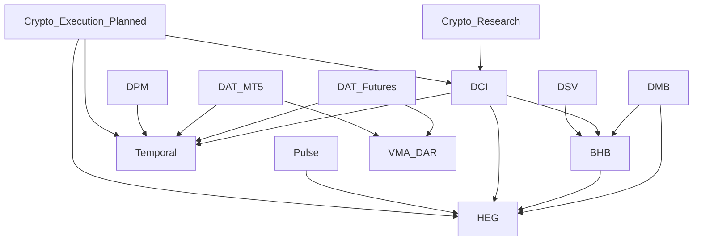

# Directive Master Brain — shadow architecture v1

DMB provides one strategic portfolio contract and local communication facade over
the existing BHB/HEG. The authoritative registry is
[REGISTRY.v1.json](../portfolio/REGISTRY.v1.json). Evidence controls status;
unknown repositories, target identities and historical milestones remain unknown.
The local trusted shadow prototype passes. **Overall DMB SHADOW CERTIFIED is
BLOCKED** by the live gates in [certification](evidence/DMB_CERTIFICATION.json).

## Registry and dependency graph

All 13 records include verified scope, objectives, dependencies, blockers,
approval gates, workspace, repository, assigned worker and next safe action.
`null` is an explicit unknown value. The DAT Temporal Integration approval is
preserved as the user's historical instruction; its implementation is unverified.
The additional planned crypto execution record is gated and has no execution code.

[Machine dependency graph](evidence/DMB_DEPENDENCY_GRAPH.json) records target
integration edges. These do not certify integrations or block independent labs.
Task dependencies are separate immutable job IDs; only successful completion
releases a dependent task. Dependencies must already be registered, preventing
cycles and undefined predecessor references. Scheduling uses priority, then
registration order, subject to all resource/authorization constraints.

## Planner, workers and durable authority

DMB uses a dedicated BHB SQLite database with transactional `master_jobs`,
resource locks, heartbeat tables and a pinned registry/worker binding. The
ordinary BHB Runner mechanically rejects DMB dispatch. Stable task/correlation
IDs and canonical scope bind project, fixed operation, dependency IDs, priority,
expiry duration, registry version, worker workspace, reviewed Git commit, source
hashes and budgets. Exact retries return existing state; conflicting identity,
route, stale fence or altered configuration fails closed.

Three shadow labs are stored as inspectable snapshots and hash-pinned Git bundles
under `workstreams/`. The observed worker manifests use separate Linux paths.
The labs contain BHB/HEG tests, synthetic DAT Futures/MT5 arithmetic and synthetic
DPM scenario research. They do not assert access to actual DAT/DPM repositories.
Codex collaboration workers developed the labs concurrently; the deterministic
Runner independently starts and verifies their reviewed code in concurrent
processes. This verifies routing and execution without pretending new live
Codex agent turns have completed.

Operations are a fixed allowlist. `verify_lab` runs the pinned test module with
fixed argv and no shell. `codex_review` identifies the existing official
`codex exec --sandbox read-only --json --ephemeral` prototype, but returns proven
pre-start unavailability until its independent runtime/resource/identity gate
passes. Free-form mailbox prompts, commands, environment overrides and provider
credentials are not accepted. Code-changing live worker delegation is pending.

At most three workers and 768 MB of scheduling reservations are admitted. Each
Linux verifier has 256 MB address-space, 10 CPU seconds, 20 wall seconds, 1 MB file
output and 64 descriptors. A timeout kills the process group. These are
per-process limits and scheduler reservations, **not an aggregate host/cgroup
memory guarantee**. Fixed code is trusted and reviewed; workspace paths, clean
Git and source hashes provide logical separation. Same-UID workers are **not
hostile-code filesystem/network confinement**. Windows non-admin identity and
stronger OS containment remain blocked; no elevation or security bypass occurred.

A started worker with uncertain completion becomes `NEEDS_HUMAN`; its locks and
resource reservations remain held across restart. An ordinary approval cannot
retry it. Proven pre-start failure retries at most three times with bounded
backoff, then blocks the task and releases its unused reservation. Failed
predecessors leave dependent jobs blocked. PAUSE prevents new dispatch; it does
not claim to stop already running work.

## Central Brain and HEG

One local MCP stdio facade exposes `dmb_submit_job`, `dmb_job_status`,
`dmb_portfolio_report` and `dmb_control`. All project routes use the central BHB
inbox/outbox and retain correlation IDs. The portfolio report contains unknown
project states, worker activity/quarantine, held locks, heartbeat observations,
human requests, simulated delivery state and audited result messages. Recent
job/outbox/human/delivery records are capped at 100 with totals and explicit
truncation; full durable state remains addressable by task ID.
The stdio handshake and delivery/result return pass in separate processes.

Supported Codex noninteractive/app-server interfaces and ChatGPT remote MCP plus
MCP Events are the intended integration paths. Existing research references:

- https://developers.openai.com/codex/noninteractive
- https://developers.openai.com/codex/app-server
- https://developers.openai.com/plugins/build/mcp-server
- https://developers.openai.com/plugins/build/mcp-events

These references support an interface design, not a live certification claim.
An ordinary ChatGPT conversation cannot be assumed to poll files or self-wake.
Remote OAuth/subscription/webhook authentication, event delivery, permissions and
human approval binding must be independently certified before connection.

The fallback is an independently launched foreground deterministic Brain/planner
worker with durable state and a strategic ChatGPT reviewer. Restart recovers
state without ChatGPT/OpenClaw/DSV. The implementation is not an autonomous LLM
reasoning engine; an optional model service would need separate account/cost,
authentication and deployment approval. No persistent service was installed.

HEG is reused in simulation mode. Exact authenticated synthetic identity,
request ID, scope and expiry gate simulated infrastructure markers. Delivery
acknowledgement is never approval. Primary simulated WhatsApp failure triggers
independent simulated email, bounded retries and audit. Both channels can fail
while unrelated work proceeds. No provider/account/credentials were activated.
Control-plane degradation retains the prescribed red banner and cannot be
cleared by an ordinary approval. External WhatsApp/Pulse and backup email need
separate approval and certification; production services were untouched.

## Temporal and integration

`src/dci/master/workflows.py` defines JSON-compatible inputs, activity fences and
signals. An eventual Temporal workflow must schedule activities; SQLite and
subprocess I/O belong in activities, not deterministic workflow code. Replays
reuse stable IDs, scope and fences. No Temporal SDK/server or distributed
exactly-once effect is claimed. DSV, Pulse, VMA/DAR, DAT, DPM and OpenClaw
integration remains read-only design work until repository evidence, isolated
identities and required approvals exist. The approved DAT Temporal milestone
and all production controls remain intact.
